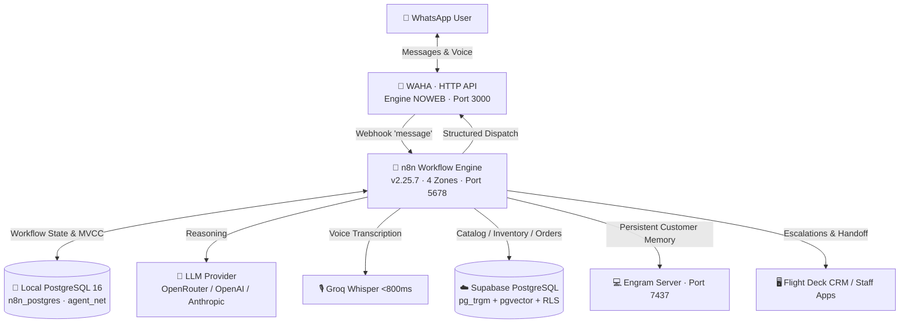

# 🏛️ Enterprise WhatsApp AI Sales Agent — System Architecture

An in-depth architectural guide for deploying an autonomous, production-ready WhatsApp AI Sales and Customer Support Agent with local orchestration, hybrid RAG retrieval, and real-time flight deck monitoring.

---

## 1. Overview & Architectural Philosophy

Traditional AI chatbots often rely on costly serverless API gateways, expensive recurring VPS servers, and naive single-prompt LLM wrappers that hallucinate prices and stock.

This project implements a **Clean, Event-Driven, Multi-Layer Architecture**:
- **Data Sovereignty & Local Orchestration**: Core reasoning and orchestration run locally via Docker (`waha_agent`, `n8n_postgres` on `postgres:16-alpine`, and `n8n_agent` v2.25.7), eliminating recurring middleman infrastructure costs and SQLite write-mutex bottlenecks.
- **5-Layer Hybrid Retrieval (RAG)**: Combines deterministic lexical matching, catalog synonym dictionaries, fuzzy trigrams, pgvector cosine embeddings, and LLM semantic recovery to achieve sub-second lookup across thousands of SKUs.
- **Fail-Safe Human Handoff**: Detects ambiguous intents, negative feedback, or employee intervention via WhatsApp, seamlessly transferring conversations to human staff without message loss.
- **Dynamic White-Labeling**: Business policies, agent personas, working hours, currencies, and dispatch rules are fully decoupled into environment variables (`.env`) and modular configuration files.

---

## 2. The 5-Layer Hybrid Search Pipeline (RAG)

Customers query products in natural conversational language (*"the glue for PVC pipes"*, *"gray cement 1/2"*), which rarely matches official catalog titles. The search engine executes a multi-layer cascade:

| # | Layer | Implementation | Purpose & Tradeoffs |
| :- | :--- | :--- | :--- |
| **1** | **Deterministic Lexical** | AST normalizer, dimension parser (`2x1`, `1-1/2"`), custom stopword filtering | Resolves ~70% of standard queries in under 50ms with zero LLM API cost. |
| **2** | **Catalog Dictionary** | Inverted synonym map (`catalogo_vocabulario`) | Handles regional slang and colloquial product names (e.g. *chapa* → lock). |
| **3** | **Fuzzy Trigram (`pg_trgm`)** | PostgreSQL GIN index with similarity thresholds | Recovers from misspellings and single-character typos. |
| **4** | **Vector Search (`pgvector`)** | `text-embedding-3-small` cosine distance (<0.45) | Captures semantic phrasing variations. Optional layer; safely falls back if disabled. |
| **5** | **Semantic Recovery** | Structured LLM prompt over category taxonomies | Discovers intent when customers describe product *function* rather than name. Successful hits feed Layer 2. |
| **★** | **Sales Popularity Reranking**| Historical purchase frequency weighting | Prioritizes frequently purchased items over stale catalog entries. |

---

## 3. Workflow Orchestration in n8n (4 Logical Zones)

The n8n workflow processes inbound WhatsApp webhooks through 4 decoupled zones:

1. **Zone 01 — Ingestion & Deduplication**:
   - Immediate HTTP 200 acknowledgment to WAHA (<15ms).
   - Redis/in-memory message ID deduplication to prevent duplicate webhook processing.
   - Token bucket rate limiting and `fromMe` employee intervention detection.

2. **Zone 02 — Pre-Processing & Audio Stream**:
   - Media switch detecting text vs voice messages.
   - Voice note transcription via Groq Whisper in <800ms.
   - Debounce buffer (3-second window) for burst messages.
   - Session state loading from Supabase.

3. **Zone 03 — Hybrid Routing & Tools**:
   - Intent classification router (General inquiry, product query, quotation, support).
   - Execution of `buscar_productos` or `hacer_presupuesto`.
   - Tool calling with strict no-hallucination constraints.

4. **Zone 04 — Structured Dispatch & CRM Integration**:
   - Output markdown normalization (enforcing single `*` for WhatsApp bold formatting).
   - Direct database dispatch to `atenciones_pendientes` and `solicitudes_ayuda`.
   - Outbound HTTP call to WAHA API for message transmission.

---

## 4. Container Topology, Dual-Database Split & Operational Resilience

### 4.1. Dual-Database Separation (Local Orchestrator State vs. Remote Business Data)
- **Local Orchestrator State (`n8n_postgres` · `postgres:16-alpine`)**: Dedicated internal PostgreSQL 16 service on the `agent_net` bridge network without host port exposure. Stores n8n v2.25.7 internal state (workflows, encrypted credentials, users, API keys, and failed execution logs) using MVCC concurrency (`DB_TYPE=postgresdb`, `DB_POSTGRESDB_POOL_SIZE=25`, `DB_POSTGRESDB_CONNECTION_TIMEOUT=60000`). Replaces legacy SQLite (`database.sqlite`) to eliminate `SqliteWriteConnectionMutex` lock timeouts and absorb cold-boot WAHA `FULLSYNC` webhook bursts alongside 15-second `Reenviar Ayuda` polling.
- **Remote Business Database (Supabase PostgreSQL + `pg_trgm` + `pgvector` + RLS)**: Authoritative cloud database for the SKU catalog (`productos`), exchange rates (`tazas`), customer profiles (`clientes`), conversational session state (`chat_sessions`), sales records, and staff escalation queues (`atenciones_pendientes`, `solicitudes_ayuda`).

### 4.2. Docker Compose Services (`docker-compose.yml`)

| Service | Image / Build | Container & Network | Limits & Tuning | Storage Volumes |
| :--- | :--- | :--- | :--- | :--- |
| **`waha`** | `devlikeapro/waha:latest` | `waha_agent` · port `3000:3000` on `agent_net` | `mem_limit: 1200m` · engine `NOWEB` | `waha_session_storage:/app/.sessions` |
| **`postgres`** | `postgres:16-alpine` | `n8n_postgres` · internal-only on `agent_net` (no host port) | `mem_limit: 512m` · `max_connections=60`, `shared_buffers=128MB`, `work_mem=4MB` · `pg_isready` healthcheck | External `n8n_pgdata:/var/lib/postgresql/data` |
| **`n8n`** | `whatsapp-agent-n8n` (`Dockerfile`, n8n v2.25.7) | `n8n_agent` · port `5678:5678` on `agent_net` · `depends_on: waha` (`service_started`), `postgres` (`service_healthy`) | `mem_limit: 2048m` (`--max-old-space-size=1536`) · `DB_POSTGRESDB_POOL_SIZE=25`, `DB_POSTGRESDB_CONNECTION_TIMEOUT=60000` · `EXECUTIONS_DATA_SAVE_ON_SUCCESS=none`, `EXECUTIONS_DATA_SAVE_ON_ERROR=all`, `EXECUTIONS_DATA_MAX_AGE=48`, `EXECUTIONS_DATA_PRUNE_MAX_COUNT=500` | External `n8n_data:/home/node/.n8n` (retains `config` `encryptionKey`, runtime artifacts, and legacy `database.sqlite` backup) |

Local PostgreSQL credentials are configured via `.env`: `N8N_PG_DATABASE` (default `n8n`), `N8N_PG_USER` (default `n8n`), and `N8N_PG_PASSWORD` (auto-generated as a random secret by `setup.js` when unset).

### 4.3. Lifecycle, Watchdog & Migration Tooling
- **Ordered Provisioning & Boot (`setup.js`, `boot_serrucho.ps1`, `boot.ps1`, `start_agent.ps1`)**: Idempotently create external volumes `n8n_data` and `n8n_pgdata`, start `waha` and `postgres` first, and launch `n8n` once the database is ready.
- **Health Auditing & Self-Healing (`waha_watchdog.ps1`, `tools/system_health.ps1`)**: Monitor and recover `n8n_postgres` (validating `pg_isready` / container health) prior to starting or restarting `n8n_agent`, alongside `/healthz`, WAHA session state, and Engram checks.
- **State Migration (`scripts/migrate_sqlite_to_postgres.js`)**: Idempotent migration utility executed inside the `n8n` container; opens legacy `/home/node/.n8n/database.sqlite` strictly read-only (`OPEN_READONLY`) and upserts n8n state tables into PostgreSQL within a single ACID transaction while synchronizing serial sequences without logging sensitive payloads. Legacy `tools/prune_n8n_db.js` is superseded in production by PostgreSQL and native n8n execution pruning.

---

## 5. Security, Isolation & Row-Level Security (RLS)

- **Principle of Least Privilege**: The agent interacts with the Supabase PostgreSQL database using a restricted database role (`agent_readonly`).
- **Data Protection**: Direct mutations (`INSERT`, `UPDATE`, `DELETE`) on core inventory tables are prohibited from the agent connection, while local orchestrator state in `n8n_postgres` remains isolated inside the `agent_net` Docker bridge without host port exposure.
- **Rate Limiting**: Prevents denial-of-service or bot spam via per-phone rate limiting windows in `chat_sessions`.

---

## 6. Operations & Flight Deck CRM

The companion Next.js application (`dashboard/`) provides real-time operational visibility:
- **Live Terminal & RAG Studio**: Allows developers and administrators to simulate queries and inspect hit layers, latencies, and token costs in real time.
- **Customer Attention Queue**: Visualizes conversations requiring human escalation or delivery coordination.
- **PWA & Offline Capability**: Installable Progressive Web App for mobile and desktop management.
