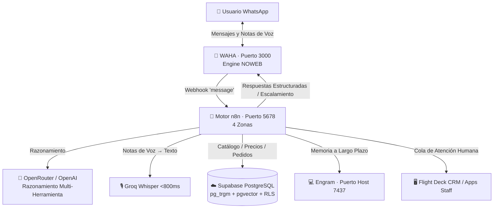
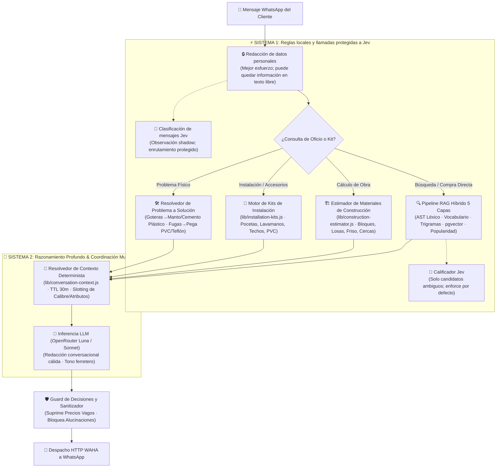
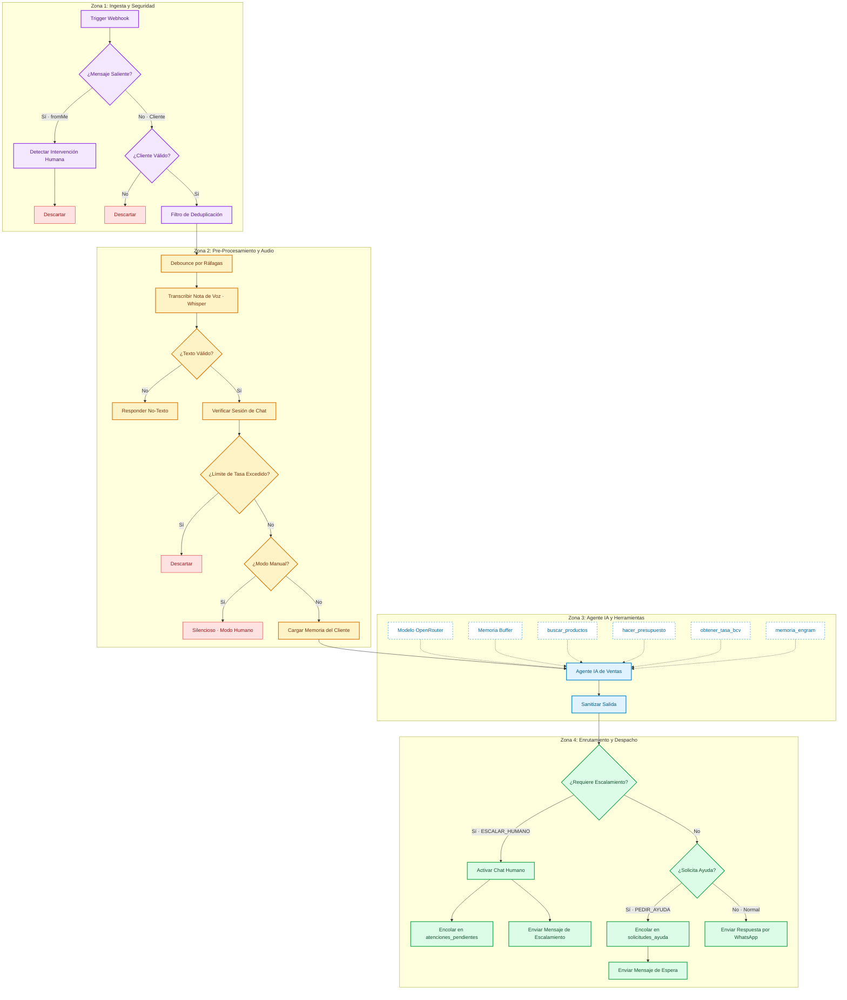

<div align="center">

  

  # Agente de Ventas IA para WhatsApp

  <p align="center">
    <strong>Motor autónomo de ventas y atención al cliente para WhatsApp de nivel de producción.</strong><br>
    Búsqueda híbrida en 5 capas, transcripción de notas de voz en &lt;800ms, memoria persistente y escalamiento a humanos.
  </p>

  <p align="center">
    <a href="README.md"><strong>English</strong></a> · <a href="README.es.md"><strong>Español</strong></a>
  </p>

  <p align="center">
    <a href="https://nodejs.org/"></a>
    <a href="https://www.docker.com/"></a>
    <a href="https://n8n.io/"></a>
    <a href="https://supabase.com/"></a>
    <a href="docs/jev-shadow-pilot.md"></a>
    <a href="tests/"></a>
    <a href="scripts/"></a>
    <a href="https://nextjs.org/"></a>
    <a href="LICENSE"></a>
  </p>

</div>

---

## 🏗️ Arquitectura

Basada en eventos. Los mensajes de WhatsApp llegan a través de WAHA, n8n orquesta con LLMs vía OpenRouter, consulta PostgreSQL en Supabase y almacena la memoria de clientes mediante Engram.



### 🧰 Stack Tecnológico

| Componente | Tecnología | Propósito |
| --- | --- | --- |
| HTTP API WhatsApp | WAHA (Docker, motor NOWEB) | Emulación de sesiones multidispositivo y despacho de webhooks |
| Orquestador de Flujos | n8n (Docker) | Gestión de eventos, enrutamiento de estado, rate limiting y despacho de herramientas |
| Razonamiento LLM | OpenRouter / OpenAI | Razonamiento multiturno e invocación de herramientas |
| Modelado de Decisiones | TypeSafe Jev vía Vercel AI Gateway + motores deterministas | Enrutamiento protegido y calificación de candidatos ambiguos; reglas locales para cálculos |
| Transcripción de Voz | Groq Whisper | Transcripción de notas de audio en <800ms |
| Base de Datos y Búsqueda | Supabase (PostgreSQL + pg_trgm + pgvector) | Catálogo de inventario, cola de pedidos y búsqueda vectorial híbrida |
| Estado y Memoria | Engram + Contexto de Sesión en Memoria | Perfilado de clientes y caché de atributos con TTL de 30 minutos |
| Flight Deck & CRM | Next.js 14 (App Router + Tailwind + GSAP + PWA) | Telemetría en vivo, cola de operaciones de chat, estudio RAG, consola DevOps |
| Runtime y Testing | Node.js 22+ (Native Test Runner) | Herramientas CLI, guardias de sincronización y pruebas automatizadas de regresión |

---

## 🔍 El Pipeline de Búsqueda Híbrida de 5 Capas (RAG)

| # | Capa | Implementación | Qué Resuelve |
| --- | --- | --- | --- |
| 1 | AST Léxico | ilike + parseador de dimensiones (NxM, fracciones, calibre) | Consultas base en ~50ms sin costo de API (~70% del volumen) |
| 2 | Diccionario de Catálogo | Tabla de sinónimos invertida (catalogo_vocabulario) | Jerga regional y coloquialismos |
| 3 | Trigramas Fuzzy | Índices de similitud GIN de pg_trgm | Errores ortográficos graves, letras traspuestas |
| 4 | Búsqueda Vectorial | Similitud coseno con pgvector (text-embedding-3-small) | Variaciones en la redacción |
| 5 | Recuperación Semántica | Clasificación de categorías y extracción de intención por LLM | Cliente describe la función de un producto |
| ★ | Popularidad de Ventas | Frecuencia de compra ponderada | Reordena resultados según histórico de ventas |

Ver [RAG.md](RAG.md) y [ARCHITECTURE.md](ARCHITECTURE.md) para detalles profundos de arquitectura.

---

## ⚡ Modelado de Decisiones de Vanguardia: Dualidad Cognitiva (Sistema 1 + Sistema 2)

En aplicaciones industriales y de comercio conversacional de alto volumen, enviar todas las consultas crudas a modelos fundacionales masivos (GPT-4o, Claude 3.5 Sonnet) es un antipatrón costoso: introduce latencias inaceptables (1.500–3.500 ms), costos acumulativos elevados en tokens, fallos de formato JSON y, lo más grave, **alucinaciones aritméticas en dosificaciones de obra y omisión de accesorios críticos**.

Para resolver esto con rigor de ingeniería de producción, Perucho implementa una **Arquitectura de Dualidad Cognitiva de Dos Velocidades**:

- **⚡ Sistema 1 (reglas locales y llamadas protegidas a Jev)**: Las reglas y calculadoras locales resuelven estimaciones, kits y búsqueda. Jev puede enrutar mensajes aislados elegibles y calificar candidatos ambiguos mediante llamadas en línea a Gateway. Estas llamadas añaden latencia y consumo de tokens; la redacción de datos personales es de mejor esfuerzo.
- **🧠 Sistema 2 (Razonamiento Profundo Multiturno)**: Modelos LLM (`openai/gpt-5.6-luna` y `anthropic/claude-sonnet-5`) dedicados exclusivamente a la sutileza conversacional, síntesis de transcripciones de voz de Whisper (<800 ms) y coordinación de escalamiento a empleados.



### Aspectos Técnicos Destacados para Equipos de Selección y Arquitectos de IA:

1. **Estimador Determinista de Materiales de Construcción ([`lib/construction-estimator.js`](lib/construction-estimator.js))**:
   - **El Problema en Producción**: Los albañiles, contratistas y clientes de ferretería no consultan por código SKU; preguntan: *«¿cuánto cemento y arena necesito para 400 bloques?»* o *«voy a vaciar una placa de 5x4 metros, ¿qué compro?»*. Los LLMs alucinan proporciones, usan unidades imperiales norteamericanas o inventan consumos que destruyen presupuestos comerciales.
   - **Solución Determinista**: Motor matemático calibrado según las fórmulas estándar del *maestro de obra* venezolano con rendimientos certificados:
     - **Pegado de bloques**: 12.5 bloques/m² con 5% de merma, 1 saco de cemento gris por cada 30 bloques, 0.15 m³ de arena lavada por saco.
     - **Vaciado de piso/losa (10 cm)**: 0.10 m³ de concreto/m² (0.8 sacos de cemento gris, 0.05 m³ de arena lavada, 0.075 m³ de piedra picada y 1 m² de malla truckson de refuerzo por m²).
     - **Friso / revoque de pared**: Espesor 1.5 cm (1 saco de cemento por cada 7 m² de pared, 0.025 m³ de arena fina por m²).
     - **Cercas perimetrales de alambre de púa**: Cálculo de líneas (4 o 5 hilos), separación de postes a 2.5 m (madera) o 3.0 m (cemento), grapas de fijación y rollos de alambre.
     - **Pintura de paredes**: Cobertura estándar de 30 m² por galón y 120 m² por cuñete (4 galones).
     - **Detección dimensional en lenguaje natural**: Parser de expresiones regulares con solicitud proactiva de aclaración (`aclarar: true`) si el usuario no especifica dimensiones o unidades.

2. **Motor de Kits de Instalación y Venta Cruzada Proactiva ([`lib/installation-kits.js`](lib/installation-kits.js))**:
   - **El Problema en Producción**: La mayor pérdida de conversión en retail técnico ocurre cuando el cliente compra una pieza principal (inodoro, lavamanos, láminas de techo, tubos) pero olvida los accesorios críticos de instalación (cuello de cera, canillas, sifón, pegamento PVC), teniendo que pausar su trabajo o abandonar la compra.
   - **Bundles Calibrados de Accesorios**: 5 categorías especializadas con piezas exactas y asesoría técnica incorporada:
     - `sanitario_poceta`: Herraje para poceta, canilla 1/2 × 7/8, llave de arresto 1/2, cuello de cera anti-olores, juego de tornillos de fijación al piso y teflón.
     - `lavamanos`: Grifería para lavamanos, 2 canillas 1/2 × 1/2, sifón / desagüe flexible, llave de arresto y teflón.
     - `fregadero`: Grifería (cuello de cisne), 2 canillas para fregadero, contracanasta, sifón, silicón sellador transparente y teflón.
     - `techo_laminas`: Ganchos para techo / tornillos autoperforantes con arandelas vulcanizadas, caballete cumbrera y cemento plástico para goteras.
     - `tuberias_pvc`: Soldadura líquida / pega PVC, limpiador acondicionador para PVC y cinta de teflón.
   - **Vía Doble de Activación**: Responde tanto a consultas directas de kits como mediante adjunción no intrusiva de `kit_sugerido` cuando el cliente cotiza la pieza principal, cotizando en vivo contra el inventario de Supabase (ej. Kit de Lavamanos \$13.45, Kit de Sanitario \$18.00).

3. **Resolvedor de Problema a Producto Físico ([`lib/serrucho-search.js`](lib/serrucho-search.js))**:
   - Los clientes suelen consultar desde el síntoma físico antes de conocer el producto: *"tengo una filtración en el techo"*, *"se me rompió un tubo de agua"*, *"hay una gotera"*.
   - Mapeo determinista inmediato que conecta el problema con los insumos correctos (`cemento plastico`, `manto asfaltico`, `pega pvc`, `teflon`) con salvaguardas fail-closed.

4. **Tokenizer Multiproducto en Lenguaje Natural con Lookahead ([`parseItems`](lib/serrucho-search.js))**:
   - Resuelve el despiece de listas de compras complejas en una sola línea (*"dame 2 sacos de cemento, una canilla de lavamanos y 3 metros de cable calibre 10"*).
   - Regex de límites con lookahead sobre conjunciones en español (`y`, `e`, `con`, `más`, `además`, `también`) para no fragmentar nombres compuestos válidos como *"pintura blanco y negro"*.
   - Mapeo léxico de números cardinales en texto (*"un"*, *"dos"*, *"medio"*, *"docena"*) a cantidades numéricas exactas.

5. **Observación Jev y redacción de datos ([`lib/jev-shadow.js`](lib/jev-shadow.js))**:
   - **Observación y rutas protegidas**: `JEV_MODE=shadow` añade una solicitud en línea antes del Agent, con plazo predeterminado de 1.500 ms. `JEV_ROUTING_ENABLED` y `JEV_ROUTING_SCOPE` controlan las respuestas directas; el despliegue documentado utiliza `all` para chats privados entrantes elegibles.
   - **Redacción de mejor esfuerzo**: Enmascara patrones comunes de contacto, credenciales y montos; puede quedar información personal en texto libre.
   - **Abstracción Dual-Provider**: Soporte conmutativo para **TypeSafe API** (`/v1/systemone`) y **Vercel AI Gateway** (`ai-gateway.vercel.sh`).
   - **Evaluación sintética ([`scripts/evaluate_jev.js`](scripts/evaluate_jev.js))**: El corpus de 30 casos mide intención y continuidad; otro de 12 mide etiquetas de departamento, material y problema. La búsqueda generada todavía no consume esas etiquetas. Ninguno mide una mejora del agente completo ni demuestra calibración de confianza.
   - **Calificación de productos ([`lib/jev-product-qualifier.js`](lib/jev-product-qualifier.js))**: Un control independiente `off`/`shadow`/`enforce` evalúa hasta cuatro candidatos ambiguos. Compose de producción usa `enforce` por defecto; coincidencias exactas y discrepancias duras de medidas no lo invocan. Los fallos conservan el resultado anterior. Consulta la [guía del calificador](docs/jev-product-qualifier.md) y el [registro de implementación de Jev](docs/jev-session-2026-10-01.md).

6. **Motor de Contexto Determinista y Slotting de Atributos ([`lib/conversation-context.js`](lib/conversation-context.js))**:
   - **Rastreo Técnico de Atributos Multiturno**: Preserva calibre de cables (calibre 8, 10, 12, 14), tipo de aislamiento (THW), presentación (por metro / rollo) y tonalidades entre turnos sin necesidad de re-inyección en el prompt.
   - **Máquina de Estado en Memoria con TTL de 30 min**: Aislamiento por sesión de WAHA y teléfono de cliente, forzando preguntas de aclaración (`match_status: vague`) en lugar de inferir o adivinar pedidos erróneos.

7. **Rigor de Ingeniería y Puertas de Calidad**:
   - En el último despliegue de Jev pasaron 290 pruebas de Node y 23 de Vitest, además de chequeos de tipos y sincronización. Estas pruebas no demuestran la precisión comercial en clientes; consulta el [registro fechado](docs/jev-session-2026-10-01.md).
   - **86 casos de prueba de regresión de catálogo** con **0 falsos negativos** exigidos por contrato (`node rag.js regresion`).
   - **Chequeos de sincronización (`check_sources_sync.js`, `check_workflow_sync.js`)**: Detectan diferencias entre fuentes versionadas y exportaciones generadas. El workflow desplegado en n8n requiere verificación aparte.
   - **Guardias de Cotización Comercial**: Supresión automática de precios en coincidencias vagas (`match_status: vague`), protegiendo los márgenes comerciales de la tienda.

---

## 🖥️ Flight Deck CRM & Dashboard de Operaciones

<div align="center">
  
  <p align="center"><em>Previsualización interactiva de la consola de operaciones y CRM en tiempo real.</em></p>
</div>

<br />

<table border="0">
  <tr>
    <td width="30%" align="center" valign="middle">
      
    </td>
    <td width="70%" valign="top">
      El directorio <code>dashboard/</code> contiene una aplicación complementaria completa desarrollada en Next.js 14:
      <ul>
        <li><strong>Flight Deck</strong>: Telemetría del agente en tiempo real (latencia, costos de tokens, mapa de microservicios, logs en streaming).</li>
        <li><strong>WhatsApp CRM</strong>: Espacio de trabajo de chat en vivo con detalles de prospectos, respuestas manuales y modo silencioso.</li>
        <li><strong>RAG Studio</strong>: Terminal de pruebas interactivo para inspeccionar el motor de búsqueda en 5 capas en tiempo real.</li>
        <li><strong>Visualizador n8n</strong>: Mapa topológico interactivo de nodos en las 4 zonas de ejecución.</li>
        <li><strong>Consola DevOps</strong>: Terminal de operaciones de infraestructura y monitoreo de túneles.</li>
      </ul>
    </td>
  </tr>
</table>

**Capacidades Principales y Herramientas:**
* **Autenticación**: Supabase Auth con Modo Demo instantáneo para exploración sin credenciales.
* **Progressive Web App (PWA)**: Instalable en escritorio y móviles, soporte offline con service workers y alertas web push VAPID.
* **UI/UX Moderna**: Tema oscuro lava/obsidiana, animaciones GSAP, tipografía Space Grotesk + JetBrains Mono, fondo de radar arquitectónico.
* **Full Stack & Pruebas**: Next.js 14, React 18, Tailwind CSS, íconos Lucide, pruebas unitarias con Vitest y suites E2E con Playwright.
* **Endpoints API**: `/api/conversations`, `/api/n8n`, `/api/rag`, `/api/telemetry` y `/api/tunnel`.

---

## 🤝 Sistema de Escalamiento Humano y Solicitudes de Ayuda
- **Cola de Atención** (`atenciones_pendientes`): Cuando un cliente pide hablar con un agente humano, el bot lo encola. Los empleados ven notificaciones instantáneas mediante Supabase Realtime. Una atención pendiente por teléfono (deduplicación). Protegido por RLS.
- **Solicitudes de Ayuda** (`solicitudes_ayuda`): Cuando el bot no encuentra un producto o el cliente objeta el resultado, se genera una solicitud. Los empleados seleccionan los productos correctos y n8n envía automáticamente la respuesta corregida al cliente por WhatsApp. Flujo: pendiente → resuelto → enviado.
- **Notificaciones Web Push**: Envíos push basados en VAPID al personal incluso con la app cerrada, mediante Supabase Edge Functions.

---

## 🗺️ Topología de Flujos n8n (4 Zonas)



---

## ⚙️ Flujos Auxiliares de n8n

| Flujo | Archivo | Propósito |
| --- | --- | --- |
| Auto-Mejora | `workflows/workflow_automejora.json` | Analiza fallos del agente y parchea automáticamente el prompt o la lógica de búsqueda |
| Reenvío de Ayuda | `workflows/workflow_reenviar_ayuda.json` | Redacta y envía mensajes con productos corregidos al cliente tras la resolución humana |
| Generador de Vocabulario | `workflows/workflow_vocabulario.json` | Genera y actualiza el diccionario de sinónimos del catálogo a partir de patrones de consulta |

---

## 🗄️ Esquema de Base de Datos
PostgreSQL en Supabase con RLS. Tablas clave:
- `productos` — Catálogo de productos (SKU, descripción, precio, stock, código de barras)
- `tazas` — Tasas de cambio dinámicas (BCV USD/EUR, Binance P2P)
- `clientes` — Registro de clientes
- `chat_sessions` — Estado bot/humano y rate limiting por número telefónico
- `ventas` / `ventas_detalle` — Transacciones de venta
- `ordenes_cambio` / `ordenes_cambio_items` — Ajustes de inventario
- `atenciones_pendientes` — Cola de escalamiento humano (Habilitado con Realtime)
- `solicitudes_ayuda` / `solicitudes_ayuda_items` — Cola de ayuda (Habilitado con Realtime)
- `push_subscriptions` — Suscripciones a notificaciones Web Push
- `tunnel_config` — Registro de URLs dinámicas de túneles Cloudflare ([guía de consulta](docs/tunnel-discovery.md))

Características clave: Índices GIN pg_trgm, búsqueda coseno con pgvector, políticas RLS (anon para bot, autenticado para empleados), suscripciones Supabase Realtime, funciones SECURITY DEFINER.

---

## ⚡ Inicio Rápido y Configuración

### 1. Clonar y Configurar
```bash
git clone https://github.com/Gus2708/whatsapp-agent.git
cd whatsapp-agent
cp .env.example .env
```
Editar `.env` con los datos de tu empresa (AGENT_NAME, STORE_NAME, STORE_LOCATION, STORE_SCHEDULE, STORE_CURRENCY) y llaves API (WAHA_API_KEY, OPENROUTER_API_KEY, GROQ_API_KEY, SUPABASE_URL, SUPABASE_ANON_KEY, opcionalmente OPENAI_API_KEY para embeddings pgvector).

### 2. Iniciar Servicios con Docker
```bash
docker compose up -d
```
- Dashboard WAHA: http://localhost:3000 (escanear código QR)
- Automatización n8n: http://localhost:5678

### 3. Iniciar el Dashboard Flight Deck CRM
```bash
cd dashboard && npm install
npm run dev
```
Abrir http://localhost:3001. Configurar `dashboard/.env.local` tomando como base `dashboard/.env.example`.

### 4. Aplicar Esquema de Base de Datos
Ejecutar `supabase_schema.sql` en el editor SQL de tu panel de Supabase.

### 5. Generar Embeddings (opcional, para capa pgvector)
```bash
node scripts/generar_embeddings.js
```

---

## 🧩 Fuente Única de Verdad y Protección contra Desviaciones
El motor de búsqueda principal reside canónicamente en `lib/serrucho-search.js` (con fachada `lib/catalog-search.js`). Protegido por:
```bash
npm test
```
- `check_sources_sync.js` — verifica que las fuentes canónicas coincidan con los scripts generados y las copias de nodos versionadas
- `check_workflow_sync.js` — verifica la exportación generada contra las fuentes versionadas; no compara con el n8n desplegado
- Pruebas automatizadas en Node.js y Vitest; el resultado fechado del despliegue de Jev está en el [registro de implementación](docs/jev-session-2026-10-01.md)
- **86 consultas de regresión en catálogo** sin falsos negativos (`node rag.js regresion`)
- Dashboard: Verificación estricta en TypeScript + pruebas unitarias con Vitest + suites E2E con Playwright

---

## 🌿 Ramas e Implementaciones de Referencia
- **`master`** (Por defecto): Plantilla open-source 100% marca blanca
- **`perucho`**: Implementación de referencia para Ferretería El Serrucho (ferretería en Venezuela)

---

## 📁 Estructura del Repositorio

| Ruta | Propósito |
| --- | --- |
| `dashboard/` | Dashboard Flight Deck CRM & Operaciones en Next.js (5 vistas, PWA, Supabase Auth) |
| `dashboard/components/crm/` | Espacio CRM: lista de conversaciones, ventana de chat, datos del cliente |
| `dashboard/components/rag/` | RAG Studio: terminal interactivo para pruebas de búsqueda |
| `dashboard/components/telemetry/` | Matriz de KPIs, flujo de logs en vivo, topología de microservicios |
| `dashboard/components/devops/` | Consola DevOps |
| `dashboard/components/auth/` | Proveedor de Auth + pantalla de login (Supabase Auth + Modo Demo) |
| `dashboard/components/pwa/` | Registro de service worker PWA |
| `dashboard/app/api/` | Rutas API de Next.js (conversaciones, n8n, rag, telemetría, túnel) |
| `lib/serrucho-search.js` | Motor canónico de búsqueda, AST normalizador, tokenizador multiproducto con lookahead |
| `lib/catalog-search.js` | Fachada de búsqueda de catálogo para scripts y tooling CLI |
| `lib/construction-estimator.js` | Estimador determinista de materiales (bloques, losas 10cm, friso, cercas de púa, pintura) |
| `lib/installation-kits.js` | Motor de kits de instalación y bundles de accesorios (pocetas, lavamanos, fregaderos, techos, PVC) |
| `lib/conversation-context.js` | Motor determinista de estado de conversación y slotting de atributos técnicos (calibre, tipo) |
| `lib/jev-shadow.js` | Observador en modo sombra para modelo de decisión Jev con redactor de PII corporativo |
| `lib/jev-product-qualifier.js` | Calificación protegida de candidatos ambiguos con Jev |
| `lib/workflow-overlay.js` | Generador de overlay sobre workflows n8n sin afectar la línea base |
| `scripts/evaluate_jev.js` | Harness de evaluación sintética (latencia, costo, precisión) para Jev |
| `docs/jev-shadow-pilot.md` | Especificación técnica del piloto Jev shadow y modelo de privacidad |
| `docs/jev-product-qualifier.md` | Modos, límites y reversión del calificador de productos |
| `docs/jev-session-2026-10-01.md` | Registro fechado de implementación, pruebas y entrega de Jev |
| `docs/conversation-context-pilot.md` | Especificación del resolvedor de contexto y guardias de búsqueda |
| `docs/production-workflow-baseline.md` | Documentación de línea base de producción y reproducibilidad |
| `workflows/production-baseline.json` | Línea base publicada de n8n (40 nodos, parametrizada por variables) |
| `rag.js` | Ejecutor de suites de evaluación RAG |
| `scripts/` | Más de 120 scripts operativos: parches, pruebas, constructores de flujos, generadores de embeddings |
| `workflows/` | Flujos auxiliares de n8n (auto-mejora, reenvío de ayuda, vocabulario) |
| `n8n_workflow.json` | Exportación completa del flujo del agente principal en n8n |
| `data/business_context.example.json` | Plantilla para reglas de negocio personalizadas, horarios, zonas de entrega |
| `docker-compose.yml` | Definición de contenedores para WAHA y n8n |
| `supabase_schema.sql` | Esquema completo de PostgreSQL con RLS, triggers y funciones |
| `boot.ps1` / `catchup.ps1` | Ejecutor en segundo plano y motor de recuperación de mensajes offline |
| `waha_watchdog.ps1` | Monitoreo y auto-recuperación de la sesión de WAHA |
| `tests/` | Suite de pruebas Node.js test:test (catálogo, workflow, recuperación, etc.) |
| `ARCHITECTURE.md` | Libro blanco detallado de arquitectura |
| `RAG.md` | Benchmarks de ingeniería y optimización del pipeline RAG |
| `.env.example` | Plantilla de variables de entorno en raíz |

---
