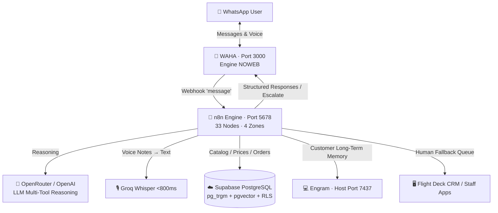
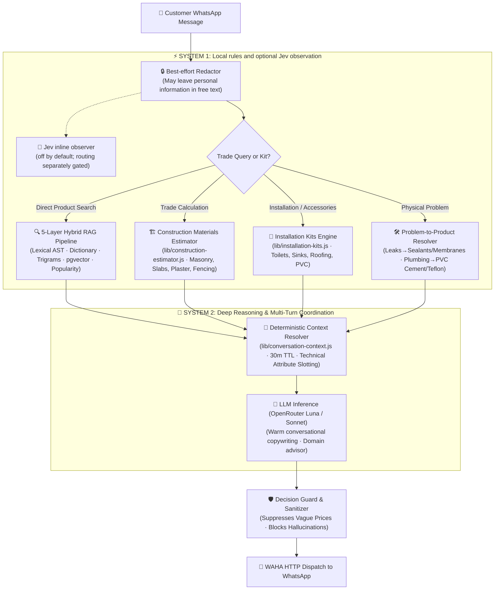
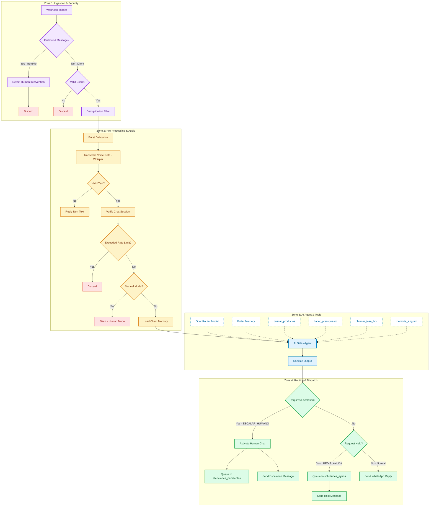

<div align="center">

  

  # WhatsApp AI Sales Agent

  <p align="center">
    <strong>Production-grade autonomous sales and customer support engine for WhatsApp.</strong><br>
    5-layer hybrid search, sub-second decision engine, deterministic trade calculators, persistent memory, and human escalation.
  </p>

  <p align="center">
    <a href="README.md"><strong>English</strong></a> · <a href="README.es.md"><strong>Español</strong></a>
  </p>

  <p align="center">
    <a href="https://nodejs.org/"></a>
    <a href="https://www.docker.com/"></a>
    <a href="https://n8n.io/"></a>
    <a href="https://supabase.com/"></a>
    <a href="docs/jev-shadow-pilot.md"></a>
    <a href="tests/"></a>
    <a href="scripts/"></a>
    <a href="https://nextjs.org/"></a>
    <a href="LICENSE"></a>
  </p>

</div>

---

## 🏗️ Architecture

Event-driven. WhatsApp messages arrive via WAHA, n8n orchestrates with LLMs via OpenRouter, queries PostgreSQL in Supabase, stores customer memory with Engram.



### 🧰 Technology Stack

| Component | Technology | Purpose |
| --- | --- | --- |
| WhatsApp HTTP API | WAHA (Docker, engine NOWEB) | Multi-device session emulation and webhook delivery |
| Workflow Orchestrator | n8n (Docker) | Event management, state routing, rate limiting, and tool dispatch |
| LLM Reasoning | OpenRouter / OpenAI | Multi-turn conversational reasoning and tool invocation |
| Decision Modeling | TypeSafe Jev / Vercel AI Gateway + Deterministic Engines | Dual-speed cognition: <0.2ms edge determinism + shadow pilot |
| Voice Transcription | Groq Whisper | Audio note transcription in <800ms |
| Database & Search | Supabase (PostgreSQL + pg_trgm + pgvector) | Inventory catalog, order queue, and hybrid vector search |
| State & Long-Term Memory | Engram + In-Memory Session Context | Customer profiling & 30-min TTL conversational attribute cache |
| Flight Deck & CRM | Next.js 14 (App Router + Tailwind + GSAP + PWA) | Live telemetry, chat operations queue, RAG studio, DevOps console |
| Runtime & Testing | Node.js 22+ (Native Test Runner) | CLI tools, sync guards, 248 hermetic tests, 86 regression queries with 0 FN |

---

## 🔍 The 5-Layer Hybrid Search Pipeline (RAG)

| # | Layer | Implementation | What It Resolves |
| --- | --- | --- | --- |
| 1 | Lexical AST | ilike + dimension parser (NxM, fractions, caliber) | Core queries in ~50ms without API cost (~70% of volume) |
| 2 | Catalog Dictionary | Inverted synonym table (catalogo_vocabulario) | Regional jargon and colloquialisms |
| 3 | Fuzzy Trigram | pg_trgm GIN similarity indexes | Severe typos, transposed letters |
| 4 | Vector Search | pgvector cosine similarity (text-embedding-3-small) | Phrasing variations |
| 5 | Semantic Recovery | LLM category classification & intent extraction | Customer describes the function of an item |
| ★ | Sales Popularity | Weighted purchase frequency | Reranks by purchase frequency |

Link to [RAG.md](RAG.md) and [ARCHITECTURE.md](ARCHITECTURE.md) for deep details.

---

## ⚡ Cutting-Edge Decision Modeling: Cognitive Duality (System 1 + System 2)

In high-volume commercial and industrial conversational AI, sending raw queries straight to heavyweight foundation models (GPT-4o, Claude 3.5 Sonnet) is an expensive anti-pattern: it introduces unacceptable latency (1,500–3,500ms), prohibitive token expenditure, unstable JSON parsing, and most critically, **arithmetic hallucinations in construction material calculations and missed accessory sales**.

To solve this with production-grade engineering, this system implements a **Two-Speed Cognitive Duality Architecture**:

- **⚡ System 1 (Deterministic Edge with optional Jev observation)**: Local rules and calculators handle material estimates, installation kits and product search. Jev is an optional inline API observation with latency and token cost; message redaction is best effort.
- **🧠 System 2 (Deep Conversational Reasoning)**: High-capability LLMs (`openai/gpt-5.6-luna`, `anthropic/claude-sonnet-5`) dedicated exclusively to conversational nuance, audio note synthesis from Whisper (<800ms), and human escalation coordination.



### Key Engineering Highlights for Hiring Teams & AI Architects:

1. **Deterministic Construction Materials Estimator ([`lib/construction-estimator.js`](lib/construction-estimator.js))**:
   - **The Production Problem**: Tradespeople and contractors do not search by SKU; they ask: *"How much cement and sand do I need for 400 blocks?"* or *"I need to pour a 5x4m slab, what should I buy?"*. Generic LLMs hallucinate proportions, use imperial units, or invent figures that ruin customer budgets.
   - **Deterministic Precision**: Calibrated mathematical engine based on verified civil engineering ratios:
     - **Masonry (Blocks)**: 12.5 blocks/m² with 5% waste margin, 1 sack of gray cement per 30 blocks, 0.15 m³ washed sand per sack.
     - **Floor Slabs (10cm thickness)**: 0.10 m³ concrete/m² (0.8 sacks cement, 0.05 m³ washed sand, 0.075 m³ crushed stone, and 1 m² welded truckson mesh per m²).
     - **Wall Plaster / Rendering (1.5cm thickness)**: 1 sack cement per 7 m² wall surface, 0.025 m³ fine sand per m².
     - **Perimeter Barbed Wire Fences**: Line counts (4 or 5 lines), post spacing at 2.5m (wooden) or 3.0m (concrete), staples and wire rolls.
     - **Painting**: Standard coverage of 30 m² per gallon and 120 m² per 4-gallon bucket (*cuñete*).
     - **Natural Language Dimension Extraction**: Regular expression parser with proactive clarification requests (`aclarar: true`) when dimensions are omitted.

2. **Installation Kits Engine & Proactive Upselling ([`lib/installation-kits.js`](lib/installation-kits.js))**:
   - **The Production Problem**: The highest drop-off in technical hardware retail occurs when customers purchase primary fixtures (toilets, sinks, roofing, piping) but forget critical installation accessories (wax ring, supply lines, traps, PVC primer/cement), halting jobs and causing returns.
   - **Calibrated Accessory Bundles**: 5 specialized categories with exact hardware and integrated trade advice:
     - `sanitario_poceta`: Flush mechanism, 1/2 × 7/8 supply line, 1/2 angle stop valve, odor-blocking wax ring, floor mounting bolts, Teflon tape.
     - `lavamanos`: Faucet, two 1/2 × 1/2 supply lines, flexible trap / drain assembly, angle stop valve, Teflon tape.
     - `fregadero`: Kitchen faucet (gooseneck), two supply lines, basket strainer, trap assembly, clear silicone sealant, Teflon tape.
     - `techo_laminas`: Self-drilling screws with vulcanized EPDM washers / roof hooks, ridge cap, plastic cement for waterproofing overlaps.
     - `tuberias_pvc`: PVC solvent cement, PVC pipe cleaner, Teflon tape.
   - **Dual Activation Pathways**: Handles direct kit inquiries and non-intrusively attaches `kit_sugerido` upsells to primary item searches, dynamically pricing against live Supabase inventory (e.g., Washbasin Kit \$13.45, Toilet Kit \$18.00).

3. **Physical Problem-to-Product Resolver ([`lib/serrucho-search.js`](lib/serrucho-search.js))**:
   - Customers often query based on physical symptoms before knowing the required product (*"my roof is leaking"*, *"burst water pipe"*, *"clogged drain"*).
   - Fast deterministic mapping connects physical symptoms to certified building supplies (`cemento plastico`, `manto asfaltico`, `pega pvc`, `teflon`) with fail-closed safety.

4. **Multi-Item Natural Language Tokenizer with Conjunction Lookahead ([`parseItems`](lib/serrucho-search.js))**:
   - Parses multi-item shopping lists in a single input (*"give me 2 bags of cement, a sink hose, and 3 meters of 10-gauge wire"*).
   - Regex boundaries with forward lookahead over Spanish conjunctions (`y`, `e`, `con`, `más`, `además`, `también`) ensuring multi-word product names (*"pintura blanco y negro"*) are not erroneously split.
   - Converts number words (*"un"*, *"dos"*, *"medio"*, *"docena"*) to exact numeric quantities.

5. **Jev observation pilot and best-effort redaction ([`lib/jev-shadow.js`](lib/jev-shadow.js))**:
   - **Inline, default-off observation**: `JEV_MODE=shadow` adds an API request before the Agent, bounded by a default 1,500ms deadline. `JEV_ROUTING_ENABLED=false` prevents Jev and rule fast paths from changing replies.
   - **Best-effort redaction**: Masks common contact, credential and currency patterns, but does not guarantee removal of personal information from arbitrary messages.
   - **Dual-Provider Architecture**: Native support for direct **TypeSafe API** (`/v1/systemone`) and **Vercel AI Gateway** (`ai-gateway.vercel.sh`).
   - **Synthetic Evaluation ([`scripts/evaluate_jev.js`](scripts/evaluate_jev.js))**: The original 30-case corpus measures intent and continuity. A separate 12-case corpus measures department, material and problem labels. The generated search tool does not yet consume these Jev labels; neither corpus measures full-agent improvement or confidence calibration.

6. **Deterministic Context Engine & Technical Attribute Slotting ([`lib/conversation-context.js`](lib/conversation-context.js))**:
   - **Multi-Turn Specification Tracking**: Preserves technical attributes such as wire gauge (8, 10, 12, 14 AWG), insulation type (THW), presentation (per-meter / spool), and color across turns without repetitive prompt reinjection.
   - **In-Memory State Machine (30-min TTL)**: Session-isolated state that triggers controlled clarification requests (`match_status: vague`) rather than guessing inaccurate products.

7. **Production Quality & Verification Gates (Zero-Hallucination Guarantee)**:
   - **248 hermetic unit tests** passing with Node.js native test runner (`npm test`), with 100% pass rate.
   - **86 regression benchmark catalog queries** requiring **0 false negatives** (`node rag.js regresion`).
   - **Single Source of Truth CI Gates (`check_sources_sync.js`, `check_workflow_sync.js`)**: Prevents drift between canonical logic in `lib/`, production dumps, and active n8n workflow nodes.
   - **Commercial Margin Safeguards**: Unguaranteed prices are suppressed automatically on approximate matches (`match_status: vague`), protecting retail margins.

---

## 🖥️ Flight Deck CRM & Operations Dashboard

<div align="center">
  
  <p align="center"><em>Previsualización interactiva de la consola de operaciones y CRM en tiempo real.</em></p>
</div>

<br />

<table border="0">
  <tr>
    <td width="30%" align="center" valign="middle">
      
    </td>
    <td width="70%" valign="top">
      The <code>dashboard/</code> directory contains a full-featured Next.js 14 companion application:
      <ul>
        <li><strong>Flight Deck</strong>: Real-time agent telemetry (latency, token costs, microservice topology map, streaming logs).</li>
        <li><strong>WhatsApp CRM</strong>: Live chat workspace with lead details, manual reply, and silent mode toggling.</li>
        <li><strong>RAG Studio</strong>: Interactive testing terminal to inspect the 5-layer retrieval engine in real time.</li>
        <li><strong>n8n Visualizer</strong>: Interactive node topology map across all 4 execution zones.</li>
        <li><strong>DevOps Console</strong>: Infrastructure operations terminal and tunnel monitor.</li>
      </ul>
    </td>
  </tr>
</table>

**Core Capabilities & Tooling:**
* **Authentication**: Supabase Auth with an instant Demo Mode for credential-free exploration.
* **Progressive Web App (PWA)**: Desktop & mobile installable, offline support via service workers, and VAPID web push alerts.
* **Modern UI/UX**: Dark obsidian theme, GSAP animations, Space Grotesk + JetBrains Mono typography, blueprint radar background.
* **Full Stack & Tests**: Next.js 14, React 18, Tailwind CSS, Lucide icons, Vitest unit tests, and Playwright E2E suites.
* **API Endpoints**: `/api/conversations`, `/api/n8n`, `/api/rag`, `/api/telemetry`, and `/api/tunnel`.
  
---

## 🤝 Human Escalation & Help Request System
- **Attention Queue** (`atenciones_pendientes`): When a customer asks to speak with a human, the bot queues them. Employees see real-time notifications via Supabase Realtime. One pending attention per phone (dedup). RLS-protected.
- **Help Requests** (`solicitudes_ayuda`): When the bot can't find a product or the customer disputes the result, it creates a help request. Employees select the correct products, and n8n automatically composes and sends the corrected response back to the customer via WhatsApp. Flow: pendiente → resuelto → enviado.
- **Web Push Notifications**: VAPID-based push to staff even with the app closed, via Supabase Edge Functions.

---

## 🗺️ n8n Workflow Topology (4 Zones)



---

## ⚙️ Auxiliary n8n Workflows

| Workflow | File | Purpose |
| --- | --- | --- |
| Auto-Improvement | `workflows/workflow_automejora.json` | Analyzes agent failures and automatically patches the system prompt or search logic |
| Help Request Forwarding | `workflows/workflow_reenviar_ayuda.json` | Composes and sends corrected product messages to customers after employee resolution |
| Vocabulary Builder | `workflows/workflow_vocabulario.json` | Generates and updates the catalog synonym dictionary from customer query patterns |

---

## 🗄️ Database Schema
Supabase PostgreSQL with RLS. Key tables:
- `productos` — Product catalog (SKU, description, price, stock, barcode)
- `tazas` — Dynamic exchange rates (BCV USD/EUR, Binance P2P)
- `clientes` — Customer registry
- `chat_sessions` — Bot/human state and rate limiting per phone
- `ventas` / `ventas_detalle` — Sales transactions
- `ordenes_cambio` / `ordenes_cambio_items` — Inventory adjustments
- `atenciones_pendientes` — Human escalation queue (Realtime-enabled)
- `solicitudes_ayuda` / `solicitudes_ayuda_items` — Help request queue (Realtime-enabled)
- `push_subscriptions` — Web Push notification subscriptions
- `servidores_tuneles` — Dynamic Cloudflare tunnel URL registry

Key database features: pg_trgm GIN indexes, pgvector cosine search, RLS policies (anon for bot, authenticated for employees), Supabase Realtime subscriptions, SECURITY DEFINER functions.

---

## ⚡ Quickstart & Setup

### 1. Clone & Configure
```bash
git clone https://github.com/Gus2708/whatsapp-agent.git
cd whatsapp-agent
cp .env.example .env
```
Edit `.env` with business branding (AGENT_NAME, STORE_NAME, STORE_LOCATION, STORE_SCHEDULE, STORE_CURRENCY) and API keys (WAHA_API_KEY, OPENROUTER_API_KEY, GROQ_API_KEY, SUPABASE_URL, SUPABASE_ANON_KEY, optionally OPENAI_API_KEY for pgvector embeddings).

### 2. Start Services via Docker
```bash
docker compose up -d
```
- WAHA Dashboard: http://localhost:3000 (scan QR code)
- n8n Automation: http://localhost:5678

### 3. Launch the Flight Deck CRM
```bash
cd dashboard && npm install
npm run dev
```
Open http://localhost:3001. Configure `dashboard/.env.local` from `dashboard/.env.example`.

### 4. Apply Database Schema
Run `supabase_schema.sql` in your Supabase SQL editor.

### 5. Generate Embeddings (optional, for pgvector layer)
```bash
node scripts/generar_embeddings.js
```

---

## 🧩 Single Source of Truth & Drift Protection
Search matcher lives canonically in `lib/catalog-search.js`. Guarded by:
```bash
npm test
```
- `check_sources_sync.js` — verifies lib/catalog-search.js matches scripts and live dumps
- `check_workflow_sync.js` — verifies n8n_workflow.json matches live system message and search nodes
- Dashboard: TypeScript strict checking + Vitest unit tests + Playwright E2E
- Root tests: catalog search, workflow guard, declared environments, paint/lamina search, recovery flow

---

## 🌿 Branches & Reference Implementations
- **`master`** (Default): Clean, 100% white-label open-source template
- **`perucho`**: Reference implementation for Ferretería El Serrucho (Venezuelan hardware store)

---

## 📁 Repository Structure

| Path | Purpose |
| --- | --- |
| `dashboard/` | Next.js Flight Deck CRM & Operations Dashboard (5 views, PWA, Supabase Auth) |
| `dashboard/components/crm/` | CRM workspace: conversation list, chat window, lead details |
| `dashboard/components/rag/` | RAG Studio: interactive search testing terminal |
| `dashboard/components/telemetry/` | KPI matrix, live log stream, microservices topology |
| `dashboard/components/n8n/` | n8n workflow visualizer |
| `dashboard/components/devops/` | DevOps console |
| `dashboard/components/auth/` | Auth provider + login screen (Supabase Auth + Demo Mode) |
| `dashboard/components/pwa/` | PWA service worker registration |
| `dashboard/app/api/` | Next.js API routes (conversations, n8n, rag, telemetry, tunnel) |
| `lib/serrucho-search.js` | Canonical core search engine, AST normalizer, multi-item lookahead tokenizer |
| `lib/catalog-search.js` | Catalog search facade for CLI scripts and dev tools |
| `lib/construction-estimator.js` | Deterministic trade materials estimator (masonry, 10cm slabs, plaster, fences, paint) |
| `lib/installation-kits.js` | Installation kits and accessory bundling engine (toilets, sinks, roofing, PVC) |
| `lib/conversation-context.js` | Deterministic short-term conversation state engine & cable query parser |
| `lib/jev-shadow.js` | Jev decision model shadow observer with PII redactor |
| `lib/workflow-overlay.js` | n8n workflow overlay generator for baseline-safe extensions |
| `scripts/evaluate_jev.js` | Synthetic evaluation harness (latency, cost, accuracy) for Jev |
| `docs/jev-shadow-pilot.md` | Engineering specification for Jev shadow pilot & privacy model |
| `docs/conversation-context-pilot.md` | Specification for short-term state resolver & typed search guards |
| `docs/production-workflow-baseline.md` | Sanitized baseline documentation & reproducibility criteria |
| `workflows/production-baseline.json` | Published production n8n baseline (40 nodes, env-parameterized) |
| `rag.js` | RAG evaluation suite runner |
| `scripts/` | 120+ operational scripts: patches, tests, workflow builders, embedding generators |
| `workflows/` | Auxiliary n8n workflows (auto-improvement, help forwarding, vocabulary) |
| `n8n_workflow.json` | Complete export of the main n8n agent workflow |
| `data/business_context.example.json` | Template for custom business rules, hours, delivery zones |
| `docker-compose.yml` | Container definitions for WAHA and n8n |
| `supabase_schema.sql` | Full PostgreSQL schema with RLS, triggers, and functions |
| `boot.ps1` / `catchup.ps1` | Production background runner and offline message recovery engine |
| `waha_watchdog.ps1` | WAHA session health monitoring and auto-recovery |
| `tests/` | Node.js test:test suite (catalog, workflow, recovery, etc.) |
| `ARCHITECTURE.md` | Deep architectural whitepaper |
| `RAG.md` | RAG pipeline engineering benchmarks and tuning |
| `.env.example` | Root environment template |

---

## 📄 License

This project is licensed under the [MIT License](LICENSE).
