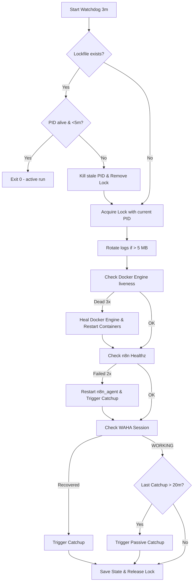

# Design: Resilient Guardrails and Self-Healing Recovery System

## Architecture Overview

The resilient guardrails system wraps the WhatsApp agent stack with four protective concentric rings:
1. **Host & Process Ring**: Mutex locking, process reap timeouts, and Docker CLI subprocess sandboxing.
2. **Docker Engine & Container Ring**: Docker daemon liveness check, automatic backend service recovery, container log size caps, and RAM limits.
3. **Application & Service Ring**: Active HTTP probes (`/healthz`, `/api/sessions`), typed schema parsing, atomic state file persistence, and automatic container restarts.
4. **Conversation & Message Recovery Ring**: Active post-crash recovery, continuous periodic passive sweep (every 20 min), cross-alias identity resolution (`@c.us` <-> `@lid`), and rate-limited injection.

```
+---------------------------------------------------------------------------------------+
| HOST LEVEL (Windows 11 + Task Scheduler every 3m)                                     |
|                                                                                       |
|  [waha_watchdog.ps1]                                                                  |
|   +-- Concurrency Guard (waha_watchdog.lock + PID stale check)                         |
|   +-- Log Rotator (5 MB limit -> .log.1)                                              |
|   +-- Subprocess Runner (Invoke-DockerCommand with 10s-25s kill timeout)              |
|   +-- State Store (Atomic Save-State + typed Get-State default fallback)              |
|   +-- Docker Daemon Prober (docker info 10s timeout -> revive backend if 3x down)     |
|   |                                                                                   |
|   +-- Layer 1: n8n Healthz Probe (http://127.0.0.1:5678/healthz)                      |
|   |    \-- If 2x down: docker restart n8n_agent -> Trigger-Catchup                    |
|   |                                                                                   |
|   +-- Layer 2: WAHA Session Probe (http://127.0.0.1:3000/api/sessions/default)       |
|   |    +-- If WORKING: check 479 stanza rejects -> reset session if needed            |
|   |    +-- If FAILED/STOPPED: stop/start session -> if 3x: restart waha_agent         |
|   |    \-- On recovery: Trigger-Catchup                                               |
|   |                                                                                   |
|   \-- Layer 3: Passive Sweeper (every 20m during steady-state)                        |
|        \-- node scripts/catchup_engine.js                                             |
|             +-- Inspects Supabase & WAHA SQLite store                                 |
|             +-- Cross-alias resolution (@c.us <-> @lid)                               |
|             \-- Injects orphaned queries into n8n webhook with 8s delay                |
+---------------------------------------------------------------------------------------+
        |                                       |
        v                                       v
+-------------------------------+       +-----------------------------------------------+
| DOCKER CONTAINER: waha_agent  |       | DOCKER CONTAINER: n8n_agent                   |
|  - mem_limit: 1200m           |       |  - mem_limit: 2048m                           |
|  - logging: max-size: 10m     |       |  - NODE_OPTIONS: max-old-space-size=1536      |
|  - max-file: 3                |       |  - logging: max-size: 10m, max-file: 3        |
+-------------------------------+       +-----------------------------------------------+
```

---

## State Transitions & Recovery Logic

### Watchdog State Schema (`waha_watchdog_state.json`)

```json
{
  "failedStreak": 0,
  "n8nFailedStreak": 0,
  "dockerFailedStreak": 0,
  "lastSendFix": null,
  "lastContainerRestart": null,
  "lastN8nRestart": null,
  "lastPeriodicCatchup": null,
  "lastDockerHeal": null
}
```

### State Machine Flowchart



---

## Failure Mode Mitigation Matrix

| Failure Mode | Root Cause | Observable Symptom | Mitigation & Guardrail |
|---|---|---|---|
| **Process Piling / Dogpiling** | Watchdog runs without lock or Docker CLI freezes | 30+ PowerShell instances, 70+ `docker.exe` processes | Mutex lockfile with PID staleness check + strict 10s/25s CLI timeout wrapper |
| **State File Null / Corruption** | Power outage or hard kill during write | 0-byte file, `$null -ne 0` evaluates `$true`, infinite restart loops | Atomic `.tmp` rename write + schema-safe parser returning typed defaults |
| **Silent Webhook Drop** | Network blip or n8n worker restart during ingress | Customer message in WAHA not in Supabase | 20-minute periodic passive catchup sweep in steady state |
| **Docker Desktop Hang** | WSL pipe disconnects or backend daemon crashes | `docker ps` hangs forever | Probing `docker info` with 10s timeout, auto-restart backend if streak >= 3 |
| **WSL Disk Exhaustion** | Unbounded Docker container logs or PowerShell logs | Disk full, SQLite write errors | `docker-compose.yml` logging max-size=10m + host log rotation at 5 MB |
| **Memory Starvation (OOM)** | V8 heap and Docker containers exceeding WSL RAM | WSL freezes, random OOM kills | `.wslconfig` (4GB RAM/4GB swap), container `mem_limit`, `NODE_OPTIONS=1536` |
| **False Human Handoff** | Empty LLM output classified as employee | 30m bot silence on customer | Empty message guard in n8n sanitizer and handoff detector |

---

## Log Rotation Strategy

Host-side logs (`waha_watchdog.log`, `boot_serrucho.log`, `catchup_serrucho.log`):
```powershell
function Rotate-LogFile([string]$path, [int]$maxBytes = 5242880) {
  if (Test-Path $path) {
    $item = Get-Item $path -ErrorAction SilentlyContinue
    if ($item -and $item.Length -gt $maxBytes) {
      $archive = "$path.1"
      Move-Item -Path $path -Destination $archive -Force -ErrorAction SilentlyContinue
    }
  }
}
```

Container stdout logs (`docker-compose.yml`):
```yaml
logging:
  driver: "json-file"
  options:
    max-size: "10m"
    max-file: "3"
```
Total maximum disk footprint of container logs is bounded to 60 MB combined across all services.
